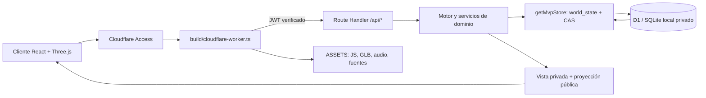
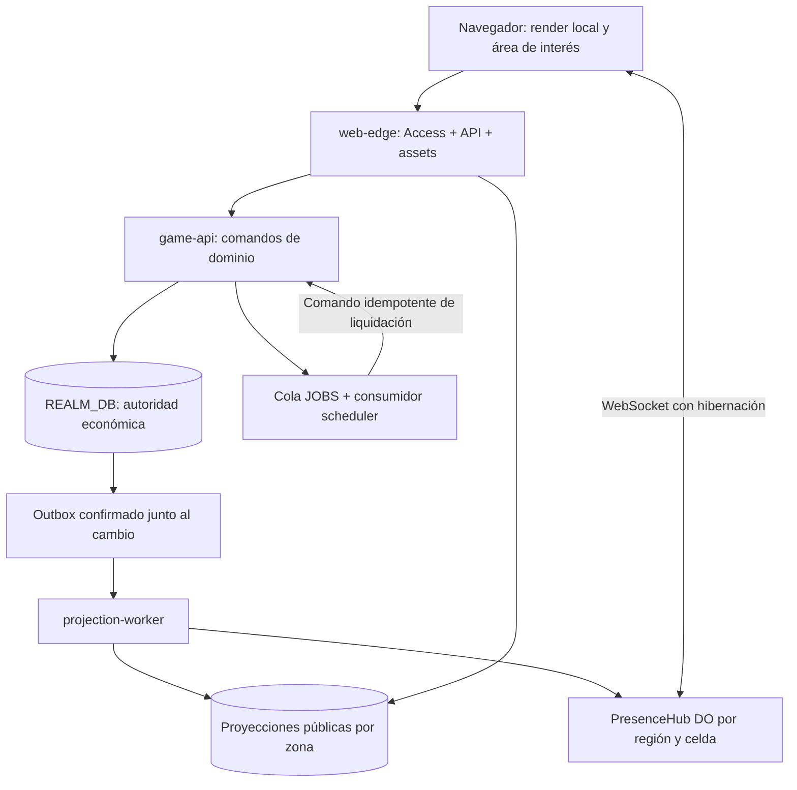

# QFrontier · Frontera Cero

Mundo medieval persistente con aldeas construibles, producción, comercio y exploración 3D con estética voxel/pixel art. Publicación del código de la alfa del **20 de octubre de 2026**, incluidos modelos, audio, esquemas SQL, herramientas y pruebas. Las partidas y la configuración privada de los servidores no se distribuyen.

> **Estado real:** `getMvpStore()` todavía selecciona `world_state`: un JSON económico con revisión y compare-and-swap. El almacenamiento particionado y las lecturas/escrituras por aldea son un candidato experimental, **no seleccionado por defecto**. Los Durable Objects, Queues y WebSockets descritos en la arquitectura de producción todavía no están conectados. Este repositorio no acredita capacidad para 3.000 ni 2 millones de usuarios simultáneos.

## Qué contiene el juego

| Área | Implementación incluida |
| --- | --- |
| Mundo | Planeta 3D con diez escalas de zoom, coordenadas, biomas, directorio de aldeas, poblados ficticios y comunidades pesqueras; proyecciones públicas de construcciones. |
| Personaje | Apariencia personalizable, modo Recorrer, cámaras aérea/primera/tercera persona, pantalla completa, teclado/mouse y controles táctiles. |
| Navegación | Red de caminos, viajes a destinos habilitados, alturas, colisiones, pasos estrechos y cesión de paso. Mover la cámara no equivale a viajar económicamente. |
| Aldea | Parcelas, expansión territorial, preparación y reciclaje, caminos, obras con progreso visible y edificios funcionales. |
| Producción | Bancal, cobertizo, mesa, puesto forestal y aserradero; habitantes asignados, transporte, reservas por obra, prioridades, previsión y balance. |
| Automatización | Encargado con turnos autorizados de 10/20 minutos, hasta 12 órdenes y 80 unidades de insumos por turno, dos trabajos paralelos y un transportista; obras aprobadas explícitamente. |
| Economía | Inventarios por lotes con procedencia y vínculo, fabricación, extracción finita, cotizaciones, Feria NPC, ofertas/contratos/convoyes, reservas y recibos idempotentes. Reglas y límites en el servidor. |
| Inicio y progreso | Primera fabricación/venta guiada, escudo inicial, XP, niveles, desbloqueos, avisos y potenciadores de prueba: máximo 20% de reducción y 30 minutos de ahorro diario por cuenta. |
| Reino del Alba | Castillo con interiores, torres, trono, guardia y mobiliario; casco urbano, puente de arcos, puerto, barcos, tiendas, taberna y entregas. |
| Tiendas y puerto | Catálogos regionales, compra con créditos internos, recogida y transporte; suministros de taberna y ventas portuarias confirmados por el servidor. |
| Gráficos y sonido | Three.js, modelos GLB optimizados, detalle por distancia, carga diferida y ciclo de vida de visores; ambiente, pasos, oficios y diálogos en español. |

Hay simulación ambiental y NPC decorativos: una animación por sí sola **no** crea pescado, monedas ni recursos. Las operaciones económicas se confirman en el dominio. QRYP, USDT, NFT, pagos externos, premios y puentes a cadena **no son una integración financiera operativa en esta versión**. Los créditos son de juego y los potenciadores no cobran dinero real.

## Ejecutar y verificar

Requisitos: **Node.js 24**, npm y una cuenta Cloudflare propia para publicar. Las dependencias exactas están en `package-lock.json`.

```bash
npm ci
npm run typecheck
npm test
npm run build
```

`wrangler.jsonc` contiene identificadores de ejemplo y ningún secreto. Para entrar por navegador configura **tu** aplicación de Access, audiencia, correos autorizados y D1 nueva. El Worker falla cerrado si falta la configuración: abrir localhost sin identidad firmada no omite la autenticación.

```bash
# Sólo después de configurar una base de desarrollo propia:
npm run db:migrate:local
npm run dev
```

Desarrollo: `127.0.0.1:5174`. El servidor privado con Tunnel usa `127.0.0.1:5180` y un perfil independiente. Consulta [Operación y despliegue](docs/architecture/OPERATIONS.md). El arranque no importa partidas de otra instalación.

## Carpetas reales y módulos

```text
qfrontier/
├── app/
│   ├── api/{mvp,mvp/quote,city-shop,royal-harbor,royal-kingdom}/route.ts
│   ├── graphics/              # Canvas, controles y paneles del mundo/reino/tiendas
│   ├── mvp-client.tsx         # Composición principal de la interfaz de la alfa
│   └── *.tsx, *.css           # Recorrer, producción, expansión, XP, audio y avisos
├── lib/
│   ├── auth/                  # JWT de Cloudflare Access
│   ├── client/                # Rutas, notificaciones y comandos de interfaz
│   ├── audio/                 # Motor de sonido, emisores y diálogos
│   ├── graphics/              # Escenas, biomas, castillo, barcos, física y modelos
│   └── mvp/                   # Dominio económico y persistencia autoritativa
├── components/ui/             # Componentes base de interfaz
├── hooks/                     # Hooks compartidos
├── build/                     # Entrada Worker protegida y adaptadores de construcción
├── db/                        # Drizzle y esquemas experimentales por entidad/aldea
├── drizzle/                   # Migración activa de world_state y metadatos
├── public/{models,audio,fonts}/# Activos servidos por la aplicación
├── scripts/                   # Runtime privado, preparación de activos, QA y carga
├── tests/                     # Reglas, conservación, persistencia, navegación y gráficos
├── docs/                      # Diseños e informes históricos; arquitectura actual abajo
├── examples/                  # Ejemplo D1 separado del juego
└── vendor/                    # CSS y avisos de terceros
```

Los nombres y subcarpetas exactos aparecen en el [catálogo completo de módulos y archivos](docs/architecture/MODULES.md), generado a partir de esta publicación.

| Módulo | Entradas y submódulos | Responsabilidad y datos |
| --- | --- | --- |
| Identidad y perímetro | `build/cloudflare-worker.ts`, `lib/auth/cloudflare-access.ts`, `app/chatgpt-auth.ts` | Firma/issuer/audience/expiración y autorización por correo. El `sub` verificado identifica la cuenta; el cliente no elige propietario. |
| API y contratos | `app/api/**/route.ts`, `lib/mvp/http.ts` | Origen, tamaño, esquema, identidad y HTTP; respuestas privadas `no-store`. |
| Orquestación | `lib/mvp/engine.ts`, `world.ts`, `view.ts` | Lee autoridad, liquida trabajo autorizado, ejecuta reglas, confirma y devuelve una vista. |
| Persistencia activa | `store.ts`, `storage-availability.ts` | JSON mundial, revisión global, CAS e indisponibilidad explícita. |
| Persistencia candidata | `partitioned-store.ts`, `partitioned-codec.ts`, `village-*.ts`, `player-read-model.ts`, `entity-versions.ts`, `db/*.sql` | Partes por entidad, versiones semánticas, contexto acotado, índices, proyecciones y confirmación transaccional. Fallback global explícito si falta cobertura. |
| Bienes y comercio | `catalog.ts`, `production.ts`, `social.ts`, `territory.ts`, `first-trade.ts` | Recetas, lotes, reservas, comercio, alianzas y primera venta; `types.ts` define contratos compartidos. |
| Construcción y trabajo | `habitable*.ts`, `land-*.ts`, `station-upgrades.ts` | Edificios, residentes, tierra, caminos, almacén y obras; `habitable-manager-*` separa previsión, balance, prioridades, reservas y transporte. |
| Viajes | `exploration*.ts`, `manual-navigation.ts`, `settlements.ts` | Destinos, rutas, tiempos, tráfico, vehículos y navegación persistida. |
| Progreso | `activity-progression.ts`, `player-progress.ts`, `level-unlocks.ts`, `boost-*.ts`, `test-boosts.ts` | XP, hitos, recetas, premios y topes compartidos entre perfiles de una cuenta. |
| Economía urbana | `city-shop*.ts`, `royal-harbor*.ts`, `royal-kingdom*.ts`, `tavern-*.ts` | Existencias, recogida, logística, producción urbana y suministros; todavía usa el almacenamiento global seleccionado. |
| Presentación 3D | `app/graphics/`, `lib/graphics/` | Reconstruye escenas con vistas confirmadas; nunca decide propiedad, pagos ni producción. |
| Sonido | `app/game-audio.tsx`, `lib/audio/`, `public/audio/v1/` | Preferencias, activación por gesto, canales y fuentes; créditos incluidos. |
| Verificación | `tests/`, `scripts/load-test*.mjs`, `scripts/test-partitioned*.mjs` | Casos económicos y de concurrencia, medición e invariantes; pruebas unitarias no equivalen a capacidad de producción. |

Las rutas de la tabla sin prefijo están bajo `lib/mvp/`.

## Flujo de datos que funciona hoy



1. Un clic produce un comando con `requestId`. La API obtiene identidad firmada, valida el cuerpo y, en MVP salvo creación, una cotización válida.
2. El motor carga el estado y liquida vencimientos autorizados con el reloj del servidor. Comprueba propiedad, cantidades, acceso, reservas, límites y revisión.
3. El cambio y su recibo quedan en la misma confirmación. Un conflicto no se convierte en segundo cobro; un reintento conserva el identificador de operación.
4. La vista confirmada alimenta interfaz, avisos y escenas. Las consultas periódicas actualizan el juego; esta alfa no tiene un bus de tiempo real de producción.
5. En PC, Access y Tunnel conducen al Worker local con SQLite persistente. En Workers, `DB` conduce a D1. **No comparten base automáticamente**.

Las API reales y sus diferencias de validación están en [Contratos y flujos](docs/architecture/PRODUCTION.md#1-contratos-de-la-api-actual).

## Arquitectura modular para una producción concreta

Siguiente implementación propuesta: realm `frontier-01`, autoridad económica transaccional D1, proyecciones públicas por zona y hubs de presencia regionales en Durable Objects. La concurrencia admisible se decide con carga real, no por el nombre de los servicios.



La economía permanece en una transacción por realm durante la primera migración; el hub de presencia no posee monedas ni inventarios. Una futura separación de mercados y aldeas entre bases requeriría reservas, confirmación y compensación; no se presupone ACID entre objetos.

El documento [Producción: carpetas, bindings, tablas, mensajes y recorridos completos](docs/architecture/PRODUCTION.md) especifica:

- Árbol objetivo `apps/web`, `apps/game-api`, `workers/{projection,jobs,presence}`, `packages/{domain,storage,protocol,render}` e `infra/`.
- De qué archivo actual sale cada módulo, qué puede escribir y qué contrato exporta.
- Recorridos de construir un cobertizo, finalizar una cosecha, vender un tablón y ver la obra del vecino desde el globo.
- Tablas y claves, versiones, recibos, outbox/inbox, reintentos, permisos y recuperación.
- Rollout con copia verificada, reconciliación, canario y reversión; sin migrar partidas mediante un despliegue de interfaz.

## Rendimiento y límites conocidos

La última medición histórica del candidato local registró 100 jugadores simulados: p95 de lectura **13,12 s**, p95 de acciones **23,95 s**, 625 peticiones mixtas y cero timeouts con un generador que toleraba 30 s. **Sigue superando** los límites de interfaz de 8/12 s. No certifica red, GPU, móvil físico, ciudades maduras ni 100 clientes WebGL simultáneos. Fuente: [Proyecciones y vencimientos compartidos](docs/PROJECTION-AND-SHARED-EXPIRY.md).

Antes de activar el candidato faltan: proyección coherente de convoyes ajenos, coste de índices/metadatos, crecimiento de historiales/directorio, medición SQL y carga representativa. La versión global sigue predeterminada. Los informes históricos citan artefactos de `work/` deliberadamente excluidos; no se presentan como evidencia reproducida en GitHub.

La GPU del dispositivo que juega dibuja sus gráficos. El servidor de PC y D1 no dibujan fotogramas para usuarios remotos. Detalle por distancia, visores ocultos pausados y área de interés acotada son decisiones del cliente.

## Seguridad, activos y colaboración

- [Seguridad](SECURITY.md): no incluir tokens, OTP, bases, correos de probadores ni snapshots en issues o commits.
- [Despliegue](docs/architecture/OPERATIONS.md): configuración propia, migraciones y separación de entornos.
- [Avisos de terceros](THIRD_PARTY_NOTICES.md): fuentes, audio, UI y modelos; licencias incluidas conservadas.
- [Validación de la publicación](docs/architecture/PUBLICATION.md): comprobaciones y limitaciones concretas.

La visibilidad pública no añade automáticamente una licencia de reutilización al código o modelos del proyecto. No se ha escogido una licencia general en nombre de sus titulares. Las dependencias conservan sus propias licencias. Imágenes promocionales y respaldos privados no están incluidos.
